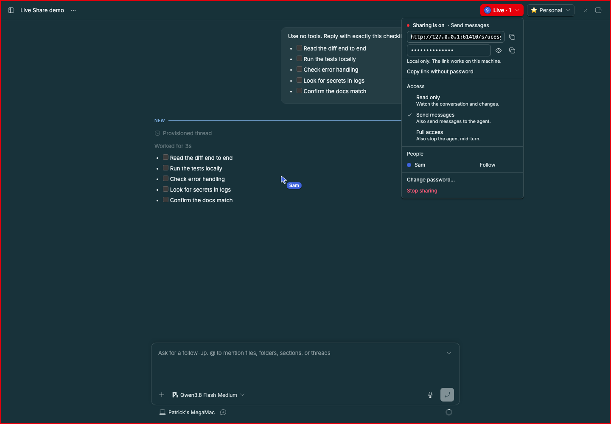
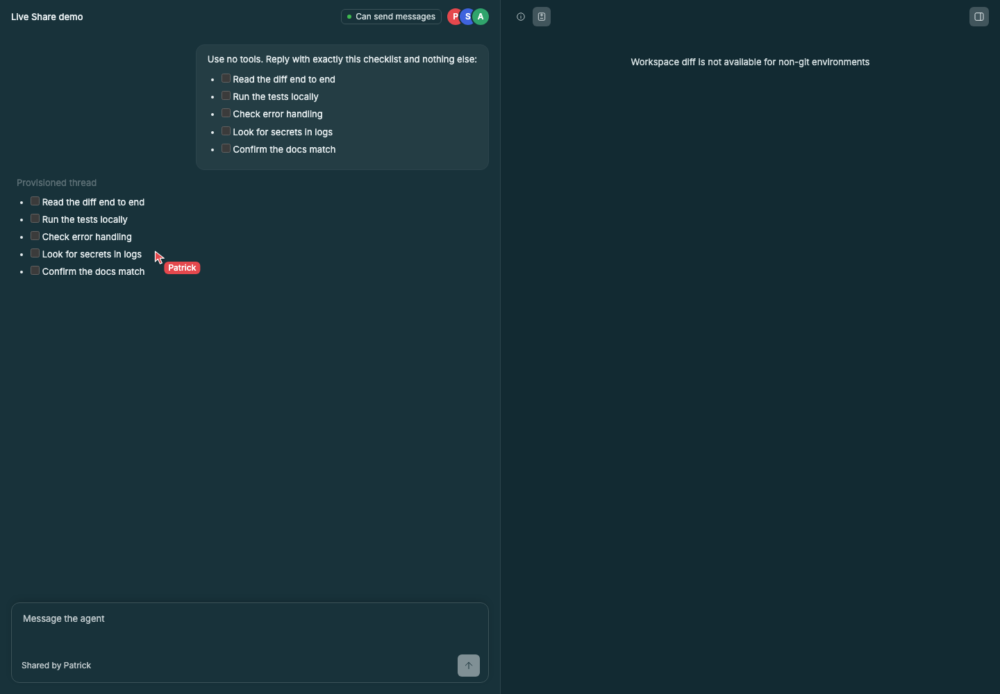

# Live Share

Share a BB thread and its workbench with another person. They open a link in
any browser, with no BB install, and see the thread the way BB shows it. You
keep working in your own BB, and you see each other's cursors.

Each share is protected by a password. You choose what the other person can do:

| Access        | Watch conversation and changes | Send messages to the agent | Stop the agent |
| ------------- | ------------------------------ | -------------------------- | -------------- |
| Read only     | Yes                            | No                         | No             |
| Send messages | Yes                            | Yes                        | No             |
| Full access   | Yes                            | Yes                        | Yes            |

## Staged preview



This screenshot is from the running BB app. A demo thread holds one agent reply,
a five-item review checklist. It is shared with **Send messages** access, and a
guest named Sam has joined through the share link. A red frame around the window
and the red **Live** button show that sharing is on. The red **Live** menu in the thread header shows the link,
the hidden password, the access level, and Sam. Sam's cursor is drawn on the
checklist in BB's own thread view.



This is the guest page for the same share, opened in a browser. It shows the
thread, the guest's access badge (**Can send messages**), the people in it, and
the host Patrick's cursor on the same checklist. The right panel is open on
the **Diff** tab; the demo thread's workspace is not a Git checkout, so it
says there is no diff to show.

## How to share

1. Open a thread and choose **Share** in the thread header.
2. Pick an access level and a password, then choose **Start sharing**.
3. Choose the copy button next to the link and send it. The copied link
   carries the password, so the other person only types their name.

The password rides in the link's fragment (`…/s/<id>#p=<password>`). Browsers
never send the fragment to a server, so the relay and the gateway never see
it, and the guest page removes it from the address bar after reading it.
Anyone with the full link can join, so treat the link as the secret. To send
the password separately instead, choose **Copy link without password**.

While a thread is shared, BB shows it plainly: the header button turns red and
reads **Live** with the number of people watching, and a red frame surrounds
the window, like a screen-share indicator. On other pages,
a red badge says which threads are shared.

The **Live** menu shows the link and the password (hidden until you choose the
eye button), copies the link with or without the password, changes access, changes the password,
removes a person, and stops sharing. Access changes apply at once. A new password signs
everyone out.

## How to join

Open the link in any browser, enter your name, and choose **Join**. If the
link has no password in it, enter the password too. A browser that has joined
before remembers the name and joins straight away. Nothing needs to be
installed. The page is laid out like BB: the
conversation in the middle, and BB's right panel with two tabs. **Info** shows
the project, environment, branch, merge base, Git status, and uncommitted
files. **Diff** shows the same changes BB's Diff tab shows by default (everything on
the branch since its merge base, committed or not) as collapsible file cards. The
rest of the host's panel tabs are mirrored too:

- A file the host opened in a tab is shown read-only with line numbers.
- The **VS Code** tab from the studio-code plugin is mirrored read-only: the
  file open in the host's VS Code, the host's selection, and the lines on the
  host's screen, refreshed about once a second. File paths are shown
  relative to the workspace, never as absolute paths on the host's disk.
  Unsaved edits are not shown, because the file is read from disk.
- Other tabs, such as terminals and browsers, appear with a note that they
  run in the host's BB and can't be shown. A badge in the
header shows the guest's access, such as **Can send messages**, and whether
the page is connected.

## How it works

- **Tunnel.** The host's BB starts a small gateway on `127.0.0.1` and publishes
  it with [OpenTunnel](https://opentunnel.xyz). TLS ends inside the plugin,
  so the relay cannot read the traffic. The tunnel keeps one hostname per BB.
  Its identity is stored in the plugin's own data directory on the host.
- **Gateway.** The gateway serves the guest page, BB's own stylesheet and
  fonts, and the Live Share guest API. It cannot reach any other part of the
  BB API. The page's content security policy blocks outside scripts, images,
  and connections.
- **Looks like BB.** The guest page uses BB's stylesheet, the host's theme,
  and the same markup as BB's thread view. Tool calls are grouped and labeled
  the way BB groups them, for example "Explored 2 searches, ran 1 command".
- **Passwords.** Guests are checked against an scrypt hash. The password
  itself is also kept in this plugin's storage on the host machine, so the
  host can see it again in the menu. It is never sent to guests. Eight wrong passwords
  within ten minutes lock that share's sign-in for the rest of the ten minutes.
  A signed-in session lasts 12 hours after its last activity.
- **Live updates.** Each guest page keeps one WebSocket open to the host. It
  carries cursors, the list of people, access changes, and thread activity.
- **Cursors.** A cursor is placed on what it points at, not on screen pixels:
  a timeline row (by BB's own row ID), a file card in the Diff tab (by path),
  or a row in the Info tab (by label). Elsewhere in the right panel it is a
  fraction of the panel, and a cursor on something only one side has (a file
  missing from the other list) falls back to the same spot in the panel. It lands on the same content even when the two
  windows have different sizes. Guest cursors are drawn over BB's own thread
  view and right panel, so the host does not need to open anything. A cursor
  shows only when the other person is looking at the same tab; the tab
  buttons show colored dots for who is on which tab.
- **Follow mode.** On the guest page, click someone's avatar to follow
  them. In BB, choose **Follow** next to a person in the **Live** menu. Your
  view then tracks theirs: the same right-panel tab, and the same row at the
  top of the conversation and the panel. The page is outlined in their color
  (in BB the frame takes their color and the header reads **Following
  <name>**). Scrolling, clicking, or a scroll key stops following. Each side
  sends its view about four times a second. When BB has not rendered the row
  a guest is on, BB first jumps to the same overall position, then settles
  on the exact row.
- **Highlights.** Selecting text shares it: everyone else sees it
  highlighted in that person's color. A selection is stored as the row and
  character offsets into its text, and drawn with the browser's CSS Custom
  Highlight API, so BB's page is never modified. Timeline selections sync in
  both directions; selections in the guest's right panel show to other
  guests only.
- **Messages from guests.** A guest's message starts with their name, such as
  `[Sam] Can you add a test?`, so the agent and the host know who wrote it. If
  the agent is busy, the message waits in the queue. It does not interrupt the
  current turn.

## Settings

| Setting        | Default      | What it does                                                                           |
| -------------- | ------------ | -------------------------------------------------------------------------------------- |
| `displayName`  | empty        | Your name, shown to people you share with. Empty means "Host".                          |
| `exposure`     | `opentunnel` | `opentunnel` publishes an encrypted public URL. `local` only listens on `127.0.0.1`.   |
| `gatewayPort`  | `0`          | Loopback port for the gateway. `0` picks a free port.                                  |

```sh
bb plugin config live-share set displayName "Patrick"
bb plugin config live-share set exposure local
```

## Limits

- Guests see the latest part of the conversation, the safe part of the Info
  tab (no machine, directory, or thread storage), and the workspace's
  uncommitted changes. They do not get a terminal, a file browser, or the
  ability to answer approval prompts.
- Guest sign-ins are kept in memory. After the host restarts BB, guests
  enter the password again.
- One share per thread.
- The tunnel hostname is public. It appears in certificate transparency logs,
  so anyone can find it. The password is what keeps the thread private.
- The first tunnel connection on a machine takes about 40 seconds, because it
  requests a certificate. Later connections reuse it.

## Development

```sh
npm install
npm run typecheck
npm run build        # bundles guest/ into src/guest-bundle.generated.ts, then bb plugin build
bb plugin install .
```

The guest page lives in `guest/`. Its bundle, `src/guest-bundle.generated.ts`,
is committed, because Git installs run only `bb plugin build`. Run
`npm run build:guest` after editing `guest/`.

Refresh the staged preview with a running BB:

```sh
BB_CAPTURE_ONLY=live-share,live-share-guest \
BB_CAPTURE_PROJECT_ID=proj_... \
BB_CAPTURE_THREAD_ID=thr_... \
node scripts/capture-plugin-screenshots.mjs
```
